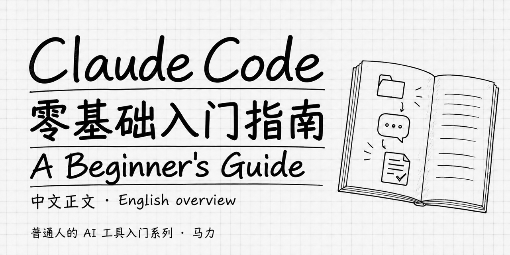

# Claude Code: A Beginner's Guide

**November 2026 update · Reviewed changes through Claude Code 2.1.316 · Haiku 5.5, Sonnet 5.5, Opus 5.5 and Fable 5.1**

[Read the complete book in Chinese](全书.md#preface) · [简体中文](README.md). This English overview introduces a free Chinese guide for people new to Claude Code, with separate Mac and Windows instructions.

**One hard question in VS Code?** Version 2.1.316 brought the terminal’s one-turn `ultrathink` effort increase to VS Code. On supported models and configurations, it can raise that turn to `xhigh` while keeping your ordinary effort setting for later turns. [Model choices and costs (Chinese)](全书.md#ch-15) · [Release notes](https://github.com/anthropics/claude-code/releases/tag/v2.1.316)

## Undo the second edit and keep the first

Suppose Claude fixed the install instructions in your README, then changed its title in a separate turn. You want the install fix and the old title. Open `/rewind`, select **the request that changed the title**, then choose **Restore code**. A checkpoint records the state before that turn. Open the README and check both details. This example uses Claude’s file editing tools on a practice copy. [Planning and recovery (Chinese)](manuscript/part2-日常使用/09-计划模式与撤销.md#undo-one-turn) · [Checkpoint documentation](https://code.claude.com/docs/en/checkpointing)

28 chapters, a preface, 11 appendices and 42 illustrations. Star the repository if you want to find the model tables, recovery example or troubleshooting guide again.

 <strong>马力 · Ma Li</strong>

## Find what you need

For a first read, follow the book in order. For reference, revisit:

- [Models and costs](全书.md#ch-15) and the [Opus 5.5 / Fable 5.1 guide](全书.md#appendix-j).
- [Reading files](全书.md#ch-05), [permissions](全书.md#ch-07), and [planning and recovery](全书.md#ch-09).
- [Review a boundary condition before committing (Chinese)](manuscript/part6-融入日常/25-团队协作基础.md#review-before-commit).
- [Project instructions](全书.md#ch-14), [Skills](全书.md#ch-20) and [troubleshooting](全书.md#appendix-g).

All chapter links lead to Chinese text. The [complete chapter list](README.md#全书阅读路线), [illustration index](assets/illustrations/读图索引.md) and [Hooks example](templates/hooks/README.md) are also available.

## Access and evidence

The book is free to read; account access and model usage may incur separate costs. Start with [account options](全书.md#ch-00).

The [November update (Chinese)](docs/2026-11-02更新.md) covers model prices, permission defaults, checkpoints and a local code review example. Feature availability depends on the client, account and provider. The book distinguishes documentation checks from hands-on runs.

## Share or improve it

A short introduction to share:

> A Chinese Claude Code tutorial for people with no programming background. From opening a terminal to organizing files, editing documents and checking results, the preface, 28 chapters and 11 appendices are readable on one page.

[Share the homepage](https://github.com/mali9527/claude-code-full-guide-for-beginners#readme) · [Read the Chinese book](全书.md#preface)

Choose **Watch → Custom → Releases** for version notifications. [Report a correction](https://github.com/mali9527/claude-code-full-guide-for-beginners/issues/new/choose) with the chapter, version and observed issue; remove private data from examples.

For a desktop-app introduction to another tool, see [Codex for Complete Beginners](https://github.com/mali9527/codex-full-guide-for-beginners), also with a complete Chinese book and an English overview.

[Releases](https://github.com/mali9527/claude-code-full-guide-for-beginners/releases) preserve fixed editions. Only Simplified Chinese is fully published; the Traditional Chinese preview has not completed language review.

© 2026 Ma Li. Original book text and teaching illustrations are licensed under [CC BY-NC-SA 4.0](LICENSE): attribution, noncommercial use and ShareAlike conditions apply. This does not authorize selling the book or packaging it into paid courses. Applying what you learn to your own work is not, by itself, commercial exploitation of the book. See the license for companion code, branding, third-party materials and legal exceptions.
