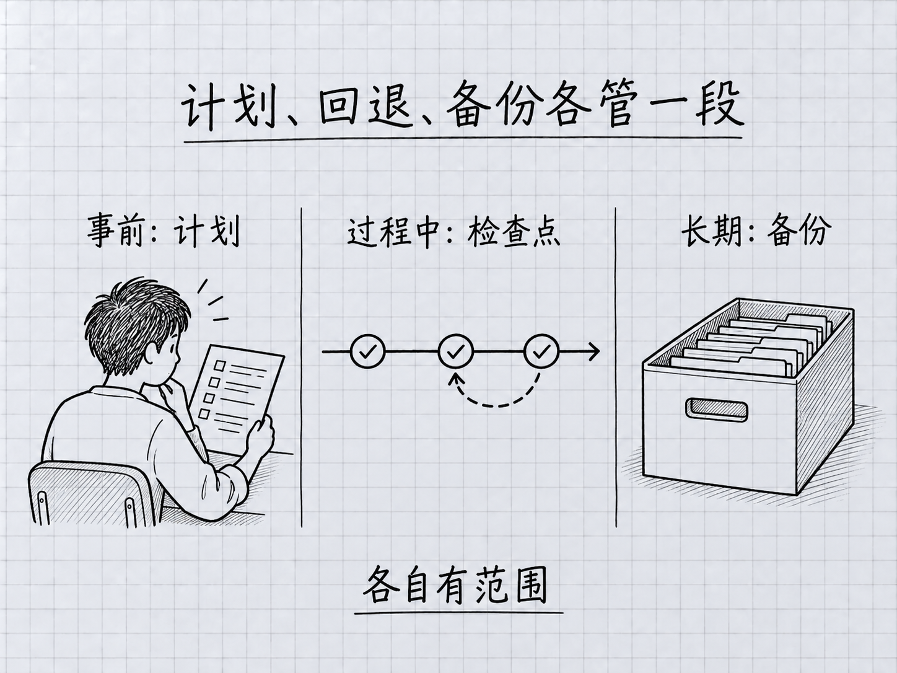

# Claude Code 零基础入门指南

**2026 年 11 月修订 · 依 2.1.316 核对本轮变化｜Haiku 5.5、Sonnet 5.5、Opus 5.5、Fable 5.1**

第一次用 Claude Code，可以从打开终端开始。已经用过的人，可以直接查怎么选模型、怎样只撤掉一轮修改，以及怎么审查项目里的改动。

**[从前言开始连读](全书.md#preface)** · [English overview](README.en.md)　·　免费中文全书　·　28 章正文，11 篇附录，42 张手绘图解

**只想让它为眼前这道难题多想一轮？** 10 月 31 日的 2.1.316 已把 `ultrathink` 的单轮用法带到 VS Code。在支持的模型和设置下，把这个词写进当前问题，Claude 的思考投入可临时升到 `xhigh`，之后仍按原来的思考设置工作。[模型如何选择与调整](manuscript/part3-深度概念/15-模型与成本.md#choose-effort) · [官方版本记录](https://github.com/anthropics/claude-code/releases/tag/v2.1.316)

**让 Haiku 5.5 提取资料，预算该看哪一行？** 按官方 API 标准价，提示不超过 10 万 token（模型处理文字的计量单位）时，每百万普通输入是 0.10 美元；超过 10 万时，对应输入单价是 0.50 美元。估算前先看单次请求用了哪一档。订阅用户查套餐用量时，走另一张表。[模型与成本](manuscript/part3-深度概念/15-模型与成本.md#api-prices) · [官方价格表](https://platform.claude.com/docs/en/about-claude/pricing)

## 两轮都改了 README，我只想撤第二轮

假设你在一个练习副本里，让 Claude 用文件编辑工具先把安装说明改对，又让它改标题。看完成品，你决定保留安装说明，把标题改回来。

| `/rewind` 菜单里显示的请求 | 你的选择 |
|---|---|
| 第一轮　修正安装说明 | 保留这一轮的成果 |
| 第二轮　修改标题 | **选这一行**，再选“只恢复文件” |

检查点保存的是该轮**开始前**的状态。打开 README，标题应当恢复原样，第一轮修好的安装说明应当还在。若期间自己也编辑了同一份受跟踪文件，先另存要留下的内容。[第 9 章，计划与撤销](manuscript/part2-日常使用/09-计划模式与撤销.md#undo-one-turn) · [官方检查点说明](https://code.claude.com/docs/en/checkpointing)

[本版还有哪些变化](docs/2026-11-02更新.md) · [查看全书手绘图](assets/illustrations/读图索引.md)

## 按手头的问题翻书

- **刚装好，第一句该输入在哪里？** 先在系统终端启动 `claude`，看到会话输入区再交代任务。[第一次对话](全书.md#ch-03)
- **昨天的任务今天继续，规则还在吗？** 找回会话后先看当前目录、权限模式和上次留下的待办。[会话与项目记忆](全书.md#ch-13)
- **接口报 401，该重新登录哪个账户？** 先认出当前生效的凭据和服务方，再决定去哪里处理。[报错自救](全书.md#appendix-g)
- **“至少 5 个文件”写成了“大于 5 个”，提交前怎么查出来？** 读改动，再用 4、5、6 三个输入复现边界。[提交前审查](manuscript/part6-融入日常/25-团队协作基础.md#review-before-commit)

下次换模型、查报错或恢复文件，可以从这几处继续。想留作手边速查，欢迎用 **Star** 收藏。

 <strong>马力 · Ma Li</strong>

展开完整阅读路线与分章目录 · 40个单元

| 阅读阶段 | 你要解决的问题 |
|---|---|
| [前言与第0—4章](全书.md#preface) | 怎么选账号、准备电脑、安装并开始第一次对话？ |
| [第5—10章](全书.md#ch-05) | 怎么读改文件、判断权限、先计划、检查结果和正确回退？ |
| [第11—15章](全书.md#ch-11) | 数据去哪里？上下文和记忆怎样工作？模型与成本怎么选？ |
| [第16—19章](全书.md#ch-16) | 新手常犯什么错？什么时候停？命令与输入有哪些入口？ |
| [第20—24章](全书.md#ch-20) | 怎么复用Skills、安排子代理、用Hooks检查、通过MCP接工具？ |
| [第25—27章与附录](全书.md#ch-25) | 怎么融入日常协作？终端、报错、模型和术语去哪里查？ |

<!-- studio:toc -->
共 40 个单元，42 张图。

1. [前言：本书怎么读](manuscript/00-%E5%89%8D%E8%A8%80/00-%E6%9C%AC%E4%B9%A6%E6%80%8E%E4%B9%88%E8%AF%BB.md)
2. [第 0 章：先选好账号与费用路径](manuscript/00-%E5%89%8D%E8%A8%80/01-%E5%85%8D%E8%B4%B9%E7%94%A8%E4%B8%8AClaude-Code.md)
3. [第 1 章：先把电脑准备好](manuscript/part1-%E4%BB%8E%E9%9B%B6%E8%B5%B7%E6%AD%A5/01-%E5%85%88%E6%8A%8A%E7%94%B5%E8%84%91%E5%87%86%E5%A4%87%E5%A5%BD.md)
4. [第 2 章：安装 Claude Code](manuscript/part1-%E4%BB%8E%E9%9B%B6%E8%B5%B7%E6%AD%A5/02-%E5%AE%89%E8%A3%85-Claude-Code.md)
5. [第 3 章：你的第一次对话](manuscript/part1-%E4%BB%8E%E9%9B%B6%E8%B5%B7%E6%AD%A5/03-%E4%BD%A0%E7%9A%84%E7%AC%AC%E4%B8%80%E6%AC%A1%E5%AF%B9%E8%AF%9D.md)
6. [第 4 章：Claude Code 到底是什么](manuscript/part1-%E4%BB%8E%E9%9B%B6%E8%B5%B7%E6%AD%A5/04-Claude-Code%E5%88%B0%E5%BA%95%E6%98%AF%E4%BB%80%E4%B9%88.md)
7. [第 5 章：让它读文件](manuscript/part2-%E6%97%A5%E5%B8%B8%E4%BD%BF%E7%94%A8/05-%E8%AE%A9%E5%AE%83%E8%AF%BB%E6%96%87%E4%BB%B6.md)
8. [第 6 章：让它改文件](manuscript/part2-%E6%97%A5%E5%B8%B8%E4%BD%BF%E7%94%A8/06-%E8%AE%A9%E5%AE%83%E6%94%B9%E6%96%87%E4%BB%B6.md)
9. [第 7 章：让它跑命令 + 权限机制](manuscript/part2-%E6%97%A5%E5%B8%B8%E4%BD%BF%E7%94%A8/07-%E8%AE%A9%E5%AE%83%E8%B7%91%E5%91%BD%E4%BB%A4%E5%8A%A0%E6%9D%83%E9%99%90%E6%9C%BA%E5%88%B6.md)
10. [第 8 章：交互循环七步法](manuscript/part2-%E6%97%A5%E5%B8%B8%E4%BD%BF%E7%94%A8/08-%E4%BA%A4%E4%BA%92%E5%BE%AA%E7%8E%AF%E4%B8%83%E6%AD%A5%E6%B3%95.md)
11. [第 9 章：计划模式与撤销——先规划，再正确回退](manuscript/part2-%E6%97%A5%E5%B8%B8%E4%BD%BF%E7%94%A8/09-%E8%AE%A1%E5%88%92%E6%A8%A1%E5%BC%8F%E4%B8%8E%E6%92%A4%E9%94%80.md)
12. [第 10 章：信任校准——什么时候信，什么时候核对](manuscript/part2-%E6%97%A5%E5%B8%B8%E4%BD%BF%E7%94%A8/10-%E4%BF%A1%E4%BB%BB%E6%A0%A1%E5%87%86.md)
13. [第 11 章：你的数据去哪了——隐私与数据流](manuscript/part3-%E6%B7%B1%E5%BA%A6%E6%A6%82%E5%BF%B5/11-%E4%BD%A0%E7%9A%84%E6%95%B0%E6%8D%AE%E5%8E%BB%E5%93%AA%E4%BA%86.md)
14. [第 12 章：Claude 为什么会变糊涂——上下文原理](manuscript/part3-%E6%B7%B1%E5%BA%A6%E6%A6%82%E5%BF%B5/12-Claude%E4%B8%BA%E4%BB%80%E4%B9%88%E4%BC%9A%E5%8F%98%E7%B3%8A%E6%B6%82.md)
15. [第 13 章：三层记忆——会话 / 自动记忆 / CLAUDE.md](manuscript/part3-%E6%B7%B1%E5%BA%A6%E6%A6%82%E5%BF%B5/13-%E4%B8%89%E5%B1%82%E8%AE%B0%E5%BF%86.md)
16. [第 14 章：写好你的 CLAUDE.md——全书最高杠杆的一章](manuscript/part3-%E6%B7%B1%E5%BA%A6%E6%A6%82%E5%BF%B5/14-%E5%86%99%E5%A5%BD%E4%BD%A0%E7%9A%84CLAUDE.md.md)
17. [第 15 章：模型与成本——怎么选、怎么算、怎么省](manuscript/part3-%E6%B7%B1%E5%BA%A6%E6%A6%82%E5%BF%B5/15-%E6%A8%A1%E5%9E%8B%E4%B8%8E%E6%88%90%E6%9C%AC.md)
18. [第 16 章：新手 10 大错误——看完能避开的坑](manuscript/part4-%E9%81%BF%E5%9D%91%E4%B8%8E%E5%88%A4%E6%96%AD%E5%8A%9B/16-%E6%96%B0%E6%89%8B10%E5%A4%A7%E9%94%99%E8%AF%AF.md)
19. [第 17 章：什么时候该停下来——不要和 AI 对抗](manuscript/part4-%E9%81%BF%E5%9D%91%E4%B8%8E%E5%88%A4%E6%96%AD%E5%8A%9B/17-%E4%BB%80%E4%B9%88%E6%97%B6%E5%80%99%E8%AF%A5%E5%81%9C%E4%B8%8B%E6%9D%A5.md)
20. [第 18 章：常用快捷命令全览——按场景找到入口](manuscript/part4-%E9%81%BF%E5%9D%91%E4%B8%8E%E5%88%A4%E6%96%AD%E5%8A%9B/18-%E5%B8%B8%E7%94%A8%E5%BF%AB%E6%8D%B7%E5%91%BD%E4%BB%A4%E5%85%A8%E8%A7%88.md)
21. [第 19 章：输入技巧——把效率榨干](manuscript/part4-%E9%81%BF%E5%9D%91%E4%B8%8E%E5%88%A4%E6%96%AD%E5%8A%9B/19-%E8%BE%93%E5%85%A5%E6%8A%80%E5%B7%A7.md)
22. [第 20 章：Skills 入门——把常用流程写成任务手册](manuscript/part5-%E6%89%A9%E5%B1%95%E8%83%BD%E5%8A%9B/20-Skills%E5%85%A5%E9%97%A8.md)
23. [第 21 章：自定义 Slash 命令——主动启动一份技能](manuscript/part5-%E6%89%A9%E5%B1%95%E8%83%BD%E5%8A%9B/21-%E8%87%AA%E5%AE%9A%E4%B9%89Slash%E5%91%BD%E4%BB%A4.md)
24. [第 22 章：Subagents 入门——把专项工作交给独立助手](manuscript/part5-%E6%89%A9%E5%B1%95%E8%83%BD%E5%8A%9B/22-Subagents%E5%85%A5%E9%97%A8.md)
25. [第 23 章：Hooks 入门——事件发生时，自动做一个小检查](manuscript/part5-%E6%89%A9%E5%B1%95%E8%83%BD%E5%8A%9B/23-Hooks%E5%85%A5%E9%97%A8.md)
26. [第 24 章：MCP 入门——连接一个确实需要的外部服务](manuscript/part5-%E6%89%A9%E5%B1%95%E8%83%BD%E5%8A%9B/24-MCP%E5%85%A5%E9%97%A8.md)
27. [第 25 章：团队协作基础——和同事一起用 Claude Code](manuscript/part6-%E8%9E%8D%E5%85%A5%E6%97%A5%E5%B8%B8/25-%E5%9B%A2%E9%98%9F%E5%8D%8F%E4%BD%9C%E5%9F%BA%E7%A1%80.md)
28. [第 26 章：进阶能力速览——按工作需要选路线](manuscript/part6-%E8%9E%8D%E5%85%A5%E6%97%A5%E5%B8%B8/26-%E8%BF%9B%E9%98%B6%E8%83%BD%E5%8A%9B%E9%80%9F%E8%A7%88.md)
29. [第 27 章：下一步路线——读完书只是起点](manuscript/part6-%E8%9E%8D%E5%85%A5%E6%97%A5%E5%B8%B8/27-%E4%B8%8B%E4%B8%80%E6%AD%A5%E8%B7%AF%E7%BA%BF.md)
30. [附录 A：Mac 终端速查](manuscript/%E9%99%84%E5%BD%95/A-Mac%E7%BB%88%E7%AB%AF%E9%80%9F%E6%9F%A5.md)
31. [附录 B：Windows PowerShell 速查](manuscript/%E9%99%84%E5%BD%95/B-Windows-PowerShell%E9%80%9F%E6%9F%A5.md)
32. [附录 C：常用 Slash 命令速查](manuscript/%E9%99%84%E5%BD%95/C-Slash%E5%91%BD%E4%BB%A4%E5%85%A8%E8%A1%A8.md)
33. [附录 D：决策流程图](manuscript/%E9%99%84%E5%BD%95/D-%E5%86%B3%E7%AD%96%E6%B5%81%E7%A8%8B%E5%9B%BE.md)
34. [附录 E：FAQ（常见问题 10 问）](manuscript/%E9%99%84%E5%BD%95/E-FAQ.md)
35. [附录 F：术语表](manuscript/%E9%99%84%E5%BD%95/F-%E6%9C%AF%E8%AF%AD%E8%A1%A8.md)
36. [附录 G：常见报错与自救手册](manuscript/%E9%99%84%E5%BD%95/G-%E6%8A%A5%E9%94%99%E8%87%AA%E6%95%91%E6%89%8B%E5%86%8C.md)
37. [附录 H：Claude Code 桌面应用简明导览](manuscript/%E9%99%84%E5%BD%95/H-%E6%A1%8C%E9%9D%A2%E5%BA%94%E7%94%A8%E5%AF%BC%E8%A7%88.md)
38. [附录 I：延伸阅读与来源致谢](manuscript/%E9%99%84%E5%BD%95/I-%E5%BB%B6%E4%BC%B8%E9%98%85%E8%AF%BB.md)
39. [附录 J：Fable 5.1 与 Opus 5.5 新手指南](manuscript/%E9%99%84%E5%BD%95/J-Opus-4.7%E6%96%B0%E6%89%8B%E6%8C%87%E5%8D%97.md)
40. [附录 K：第三方接入，先确认支持范围](manuscript/%E9%99%84%E5%BD%95/K-%E7%AC%AC%E4%B8%89%E6%96%B9%E6%A8%A1%E5%9E%8B%E6%8E%A5%E5%85%A5.md)
<!-- /studio:toc -->

另外还有[Mac终端速查](全书.md#appendix-a)、[Windows PowerShell速查](全书.md#appendix-b)、[桌面应用导览](全书.md#appendix-h)、[手绘插图索引](assets/illustrations/读图索引.md)与[Hooks教学样例](templates/hooks/README.md)，需要时再看。

## 阅读条件与当前版本

本书免费阅读，**Claude Code账号和模型使用费用另计**；先确认[账号与费用路径](全书.md#ch-00)。完整正文为简体中文，英文页面提供导览。

**十一月修订**覆盖模型、费用、权限、文件恢复、项目设置和提交前审查。本版核对范围见[十一月更新说明](docs/2026-11-02更新.md)。完整中文稿可直接连读，Mac／Windows 真实账户流程的实测状态另见[版本与核验说明](docs/版本与核验说明.md)。

## 分享、更新与反馈

推荐给第一次用Claude Code的朋友时，可以直接转发这句话：

> 一本写给不会编程的人看的Claude Code中文教程，从打开终端到整理资料、改文档和检查结果。前言、28章正文和11篇附录可以在一页连续阅读。

[分享首页](https://github.com/mali9527/claude-code-full-guide-for-beginners#readme) · [直接读全书](全书.md#preface)

接收正式版本通知：**Watch → Custom → Releases**。发现不清楚的解释或步骤变化，可到[纠错入口](https://github.com/mali9527/claude-code-full-guide-for-beginners/issues/new/choose)写明章节、客户端版本和实际现象，截图与错误信息先脱敏。

## 同系列：从桌面应用认识Codex

想通过Codex桌面应用交材料、检查成果和持续协作，可以读[《Codex完全零基础入门》](https://github.com/mali9527/codex-full-guide-for-beginners)。它从安装和第一屏讲起，无需编程基础，完整中文正文同样支持全书连读。[系列教程](docs/系列教程.md)

固定版本、语言与许可

<!-- studio:release -->
当前维护稿以本仓库为准。

已公开正文：[v2026.09.1](https://github.com/mali9527/claude-code-full-guide-for-beginners/releases/tag/v2026.09.1)。
<!-- /studio:release -->

本页与全书随维护稿更新，[发行页](https://github.com/mali9527/claude-code-full-guide-for-beginners/releases)保留固定版本。英文仅导览，繁体预览尚未完成语言审读。

© 2026 马力。本书原创正文与教学图采用[CC BY-NC-SA 4.0](LICENSE)：分享和改编须署名、仅限非商业用途，分享改编作品须遵守相同方式共享条款。不得据此出售书稿或将其打包为收费课程；学习书中方法并用于自己的工作，不等于商业利用书稿。配套代码、品牌素材、第三方材料及法定例外的范围见许可说明。

