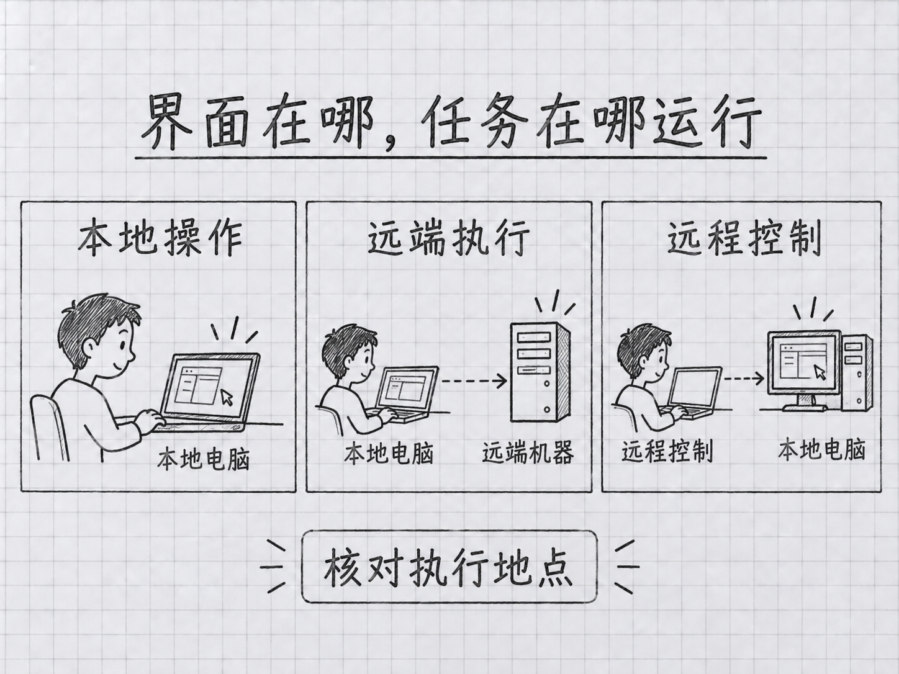

# 第 26 章：进阶能力速览——按工作需要选路线

> **本章在全书的位置**：第六部分 · 第 26 章 / 主线 20 分钟，支线 10 分钟
>
> **前置章节**：第 15 章（模型与成本）+ 第 20–25 章（扩展与协作）
>
> **学完能做什么**：分清桌面、远程、云端和三种定时方式，为下一项任务找到正确入口。
>
> 基础资料核对于 2026-09-24，本轮变化复核于 2026-11-02。这里是选择路线的指引，不要求一次学会所有功能。

## 开场三问

- **你会遇到什么问题**：听说有新模型、手机接力和自动运行，却不清楚该从哪一个开始。
- **不读这章会踩什么坑**：把“可以从手机查看”当成“电脑关机还能继续做”。
- **读完你会多会什么事**：先确认任务在哪里执行、用什么材料、怎样停止，再选择功能。

### 本章地图（一眼看全貌）

本章图解：[界面在哪，任务在哪运行](#262-想换个界面还是想换台机器执行)。

---

> 🎯 **【主线】—— 本章必读核心**

## 26.1 新模型先试熟悉任务，不必立刻改造全部流程

模型换代和 Claude Code 功能更新是两条线。安装了较新的 Claude Code，不代表账户里每个模型都已经开放；选到了新模型，也不代表所有外部连接、自动化方式都支持同样的配置。Fable 5.1、Opus 5.5 的选择与接入条件，先看第 15 章和附录 J，再以你的模型菜单与官方当期说明核对。

比较时找一项你已经会验收的任务：同一篇文档找错、同一段程序补测试、同一组材料写摘要。给各模型相同材料和目标，记录完成程度、遗漏、你需要返工的地方，以及耗时和用量。不要只比“回答有没有更长”，也不要把一次成功当成所有任务都更优。

需要更深入推理时，先确认任务说明和输入已经齐全，再考虑调整模型或思考强度。没提供关键文件却要求最高强度，可能只是让模型更认真地猜测。反过来，简单整理任务也不必为了使用最新名字而增加成本。稳定的流程保留不动，把模型选择作为其中一个可比较的因素，升级时会轻松得多。

## 26.2 想换个界面，还是想换台机器执行

**Desktop 是图形界面**，适合在一个窗口里看会话、文件和修改差异；具体入门看[附录 H](../附录/H-桌面应用导览.md)。打开桌面应用后也应看清当前会话的执行环境，不能把“在桌面窗口里看到它”理解为“一定在本机运行”。

<!-- diagram: FIG-029 -->


*图：区分代码所在位置、任务执行位置与远程控制入口。*
<!-- /diagram: FIG-029 -->

**Remote Control（远程控制）**让你从手机或浏览器接着看原机器上运行的会话，读写仍发生在原机。官方入口要求符合条件的 Claude 订阅登录，单靠 API Key 的会话不能使用；Team 或 Enterprise 还需管理员启用。先确认原机仍运行、身份符合，再从会话查看 `/remote-control`。[Remote Control 条件](https://code.claude.com/docs/en/remote-control#requirements)

**Cloud（云端会话）**则在远端环境执行。它需要取得对应仓库和运行依赖，不会自动拥有你电脑上尚未保存或尚未上传的文件。准备交给云端前，先问“它拿到的是哪份资料”，再问“能运行多久”。只有把输入交代清楚，换运行地点才有意义。[云端工作说明](https://code.claude.com/docs/en/claude-code-on-the-web)

这三者都可以帮你接续工作，但改变的是不同层面。先确定要解决的是“看起来方便”“离开电脑仍能操作”，还是“本机不在线也要执行”，就不容易选错入口。

## 26.3 三种定时方式，依赖条件不同

定时任务是让系统在约定时间再次运行提示词。选它之前，要先知道谁负责等到那个时间：当前会话、桌面应用，还是云端服务。

| 方式 | 适合的需求 | 运行条件 |
|---|---|---|
| CLI 的 `/loop` | 当前工作期间，反复检查一个状态 | 依赖本地会话与运行中的进程 |
| Desktop 本地计划 | 定期处理这台电脑上的文件 | 电脑唤醒、桌面应用运行；无需原聊天窗口一直开着 |
| 云端计划任务（原称 Routines） | 本机不在线时仍能按计划推进 | 需要在远端备好资料、连接和权限 |

例如你正在等一次构建完成，可以让 `/loop` 定期检查。它不是独立的永久服务；恢复原会话时部分任务可按规则恢复，但这不等于进程退出期间仍有人执行。[会话内调度](https://code.claude.com/docs/en/scheduled-tasks)

如果是每天整理本地资料，查看 Desktop 的本地计划。电脑睡眠时不能按原定时间执行，唤醒后可能按当前规则补最近一次，所以提示词最好写清“整理上一个完整日期的材料”，不要只写含义模糊的“今天”。[桌面计划任务](https://code.claude.com/docs/en/desktop-scheduled-tasks)

在云端定时执行可以用 `/schedule`。官方现在称为 **cloud scheduled tasks（云端计划任务）**，部分旧入口仍叫 Routines。该能力处于研究预览。先手动核对任务能访问的仓库、资料和账户，再保存触发条件。[云端计划任务](https://code.claude.com/docs/en/routines)

如果你要的是「达到结果就停」，时间并非验收标准。可以在练习项目输入 `/goal 让示例的三个边界输入全部得到预期结果，并给出运行结果`。持续任务依据对话中出现的证据判断进展，所以应要求它运行检查、报告真实输出，并自行抽查。要取消仍在进行的目标，输入 `/goal clear`。若只是要每隔一段时间查看状态，才选 `/loop`。[持续目标](https://code.claude.com/docs/en/goal)

本章只建立选择依据，**不会因为读到示例就创建任何定时任务**。真正配置时，先手动运行一遍，核对输出位置、失败处理、用量与关闭方法，再保存日程。

## 26.4 任务更多时，先拆责任，再谈自动化

第 22 章的子智能体适合有明确范围的专项阅读与审查。如果确实需要多条工作线并行，再研究团队协作或更复杂的任务编排。先写清谁负责哪个文件、谁汇总结论、谁验证最后结果，不要只是给同一个模糊目标配上多个“专家”称号。

需要把 Claude Code 接入脚本时，可以使用**非交互模式**：程序接收一次请求并输出结果，而不一直显示普通聊天界面。下面仅展示形态，不是要你马上批量处理文件：

```bash
claude -p "只阅读 README.md，用三句话说明这个练习项目做什么，不修改文件。"
```

从 2.1.302 起，未指定权限模式的 `claude -p` 和 Agent SDK 默认从 Manual 开始。需要审批却没有审批途径的调用可能被拒。例子里的“只阅读”是在交代意图；需要由程序限制能力时，`--tools` 选择内置工具，`--allowedTools` 影响哪些调用可免询问。已连接的 MCP 是另一类工具，须另行核对。重复运行前要能处理失败、超时和重复写入。[非交互权限](https://code.claude.com/docs/en/permission-modes) · [CLI 参数](https://code.claude.com/docs/en/cli-reference)

**CI（持续集成）**指仓库发生变更时自动执行检查的流程。你可以让 AI 生成审查意见、辅助写测试，但仍需要真正运行项目检查，不能把“AI 说没问题”直接当作发布条件。要在自有应用里使用这些能力，再学习 [Claude Agent SDK](https://platform.claude.com/docs/en/agent-sdk/overview)。SDK 是给程序调用的开发工具，不是零基础读完本书必须补上的课程。

## 26.5 选一条路线，把结果留下来

进阶不一定意味着自动化。你可能只是需要更清楚地审阅差异、更可靠地恢复工作，或者把每天重复的话整理成一个技能。先回看最近三次任务，哪一步花了最多时间，再选对应能力。

| 你目前最想改善什么 | 先做什么 |
|---|---|
| 看修改更清楚、管理多个任务 | 用附录 H 的练习试 Desktop |
| 离开电脑后看本地任务进展 | 了解 Remote Control 的条件 |
| 定期处理本地或仓库材料 | 先区分本节的三种调度方式 |
| 主对话材料太多 | 试一个有边界的子智能体 |
| 同类输出质量不稳定 | 固定例子、结果标准与失败样例，再改技能或提示词 |
| 集成到自己的程序 | 了解非交互模式与 Agent SDK |

每次试验留下三件东西：给它的材料、你期待的结果、实际观察到了什么。排查问题时再增加具体日志，不必为了“可观测性”这个词记录所有私人输入。日志可以帮助查错，但它不是任务真的成功的替代品，也可能含有文件内容或账户信息，分享前需要检查。

本章没有承诺某一种工具永久更便宜、更快，也没有要求追完所有更新。你只需要能说清楚：这条路线解决哪个瓶颈，代价是什么，失败时怎样回到原来可工作的方式。

## 本章小结

- 模型升级、功能升级和账户可用性要分别核对。
- Desktop 是使用界面；Remote Control 保留本地执行；Cloud 使用远端环境。
- 会话内循环、桌面本地计划和云端计划任务各有运行条件。
- 编排和程序调用需要明确失败处理、职责与验收。
- 从一个真实瓶颈选一条路线，不必同时学习全部功能。

## 动手任务

**任务 1，约 10 分钟：**选择一项真实工作，写明它的材料在本地还是远端、是否必须离线时运行、是否会修改外部内容。成功标志是你能据此选中一种运行方式。

**任务 2，约 10 分钟：**打开该方式的官方说明，记录适用条件与关闭方法，再设计一次只读的小试验。成功标志是你知道怎样证明它成功，而不仅是找到入口。

## 如果你卡住了

**菜单里没有介绍的入口：**检查运行环境、账户资格、组织设置和客户端版本，不要直接认为安装坏了。

**电脑休眠后任务没按时运行：**先判断你用的是本地计划还是云端任务；改变提示词不能让已关机的本地进程工作。

**感觉路线太多：**暂时不增加能力，继续用前面章节完成实际任务。没有遇到明确瓶颈，就没有必须学习下一种工具的理由。

---

> 🌿 **【支线】—— 可选深入（学有余力再看）**

## 🌿 支线 26.A：怎样读新功能发布消息

这段讲更新筛选；当一周出现很多新名词时回来读。

把消息拆成三个问题：改变了什么，适用于谁，有没有改变你当前的工作方式。某个功能可以运行上百个并行任务，并不说明你写一份周报也需要同样规模；某个模型在基准测试里领先，也不直接证明它更适合你的材料。

可以维护一张很短的观察表：功能、官方链接、核验日期、准备测试的任务、是否已经试过。只记录你可能用到的项目。社区示范可以带来灵感，但复现时要保留环境差异和失败结果；没有真实账号、没有对应操作系统，就写“尚未验证”，不要把一张宣传截图写成自己已经跑通的步骤。

## 🌿 支线 26.B：为自动化写明确的停止条件

这段讲长期执行的约束；当你准备启用定时或无人值守流程时回来读。

一次普通对话不满意，你通常会立刻纠正。自动化会在你不在场时再次执行，所以需要提前说明遇到什么状态就停止：资料缺失时不要编写报告、同一个失败连续出现时停止重试、没有新的变化时不重复生成同样文件。输出也应能辨认本次用了什么日期与资料，避免下一次误把旧结果当成新结果。

这些约束必须配合实际运行机制。提醒模型“别花太多钱”不是计费上限；在文本中写“只读”也不等于服务端只给了读取权限。先把可访问的目录、仓库、工具范围和运行预算配置好，再用小试验确认。停止后应能知道已做了哪些动作、哪些尚未完成，才能决定继续、修改还是撤销。

**下一章**：把你选中的路线安排进日常学习与工作。

<!-- studio:nav -->
← [第 25 章：团队协作基础——和同事一起用 Claude Code](25-%E5%9B%A2%E9%98%9F%E5%8D%8F%E4%BD%9C%E5%9F%BA%E7%A1%80.md) · [目录](../../README.md) · [第 27 章：下一步路线——读完书只是起点](27-%E4%B8%8B%E4%B8%80%E6%AD%A5%E8%B7%AF%E7%BA%BF.md) →
<!-- /studio:nav -->
